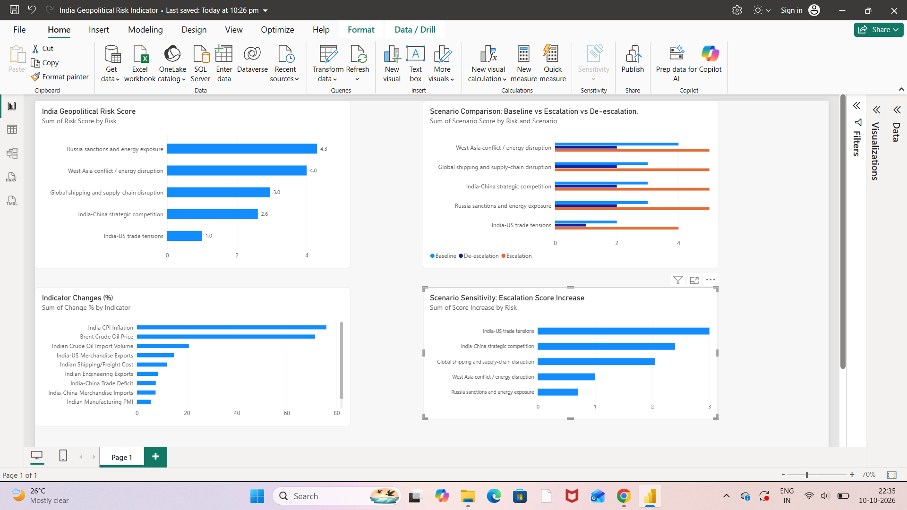

# India Geopolitical Risk & Market Exposure Engine

An exploratory research project examining how geopolitical shocks can transmit into India's economy, financial markets, supply chains, and exposed sectors.

## Research Question

When a geopolitical shock occurs, how can we trace its transmission into India's economy, financial markets, and exposed sectors?

## Project Overview

This project connects geopolitical developments to economic indicators through a structured analytical framework:

**Geopolitical event → Transmission channel → Economic variable → Market/sector exposure → Scenario analysis → Analyst assessment**

The engine examines five risk themes:

- India–US trade tensions
- India–China strategic competition
- West Asia conflict and energy disruption
- Russia sanctions and energy exposure
- Global shipping and supply-chain disruption

## Analytical Components

- **Risk database:** Structured observations of geopolitical and economic risk themes.
- **Indicator mapping:** Links risk themes to relevant economic indicators.
- **Quantitative risk scoring:** Applies analyst-defined pressure scores and indicator weights.
- **Scenario analysis:** Compares baseline, escalation, and de-escalation scenarios.
- **Sensitivity analysis:** Examines how analyst-assigned scores change under escalation assumptions.
- **Dashboard:** Visualises risk scores, indicator changes, scenario comparisons, and score increases.

## Tools

- Microsoft Excel — data preparation and model structure
- SQL — structured data storage and analytical queries
- Python (pandas, Matplotlib) — analysis, scenario comparisons, and visualisation
- Power BI — interactive dashboard development
- GitHub — research documentation and version control

## Initial Analytical Observations

The current experimental model produces the following quantitative scores:

| Risk theme | Score |
|---|---:|
| Russia sanctions and energy exposure | 4.30 |
| West Asia conflict and energy disruption | 4.00 |
| Global shipping and supply-chain disruption | 2.95 |
| India–China strategic competition | 2.60 |
| India–US trade tensions | 1.00 |

These values are outputs of the current model, not objective measurements of geopolitical risk, probabilities, or forecasts. The scores depend on the selected indicators, assigned weights, pressure classifications, and data quality.

## Dashboard

The dashboard compares the model's risk scores, selected indicator changes, scenario scores, and escalation sensitivity.

## Methodology and Limitations

This is an exploratory analytical framework rather than a validated forecasting model.

- Indicator movements do not independently establish geopolitical causation.
- Some indicator series and source values require further verification.
- The current freight-cost series is illustrative and analyst-defined, not observed market data.
- Indicator weights, pressure scores, and scenario severity scores are analyst-defined assumptions.
- The model does not calculate the probability that a geopolitical event will occur.
- Results should be interpreted alongside source-based qualitative research and relevant economic context.

## Planned Development

- Verify and document all indicator sources.
- Replace illustrative freight data with a sourced series.
- Expand historical observations and indicator coverage.
- Improve scenario assumptions and sensitivity testing.
- Add reproducible Python and SQL files.
- Refine the Power BI dashboard and document the model's limitations.
- ## Project Documentation

- [Project Guide](PROJECT_GUIDE.md) — file directory and research framework.
- [Methodology](METHODOLOGY.md) — scoring approach, assumptions, and limitations.
- [Analytical Findings](ANALYSIS.md) — interpretation of quantitative outputs.
- [SQL Analysis](sql_analysis.sql) — analytical queries for risk ranking and scenario comparison.

## Dashboard

## Author

Yavnika Singh

Research interests: geopolitical risk, political economy, international relations, economic security, and strategic risk analysis.
